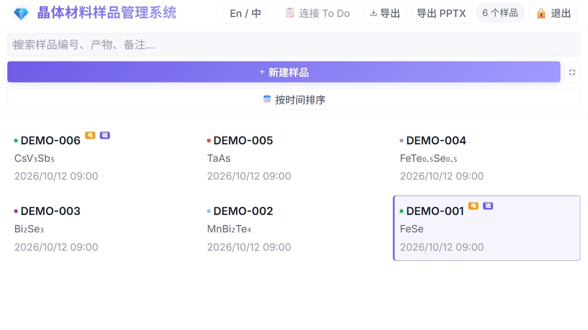
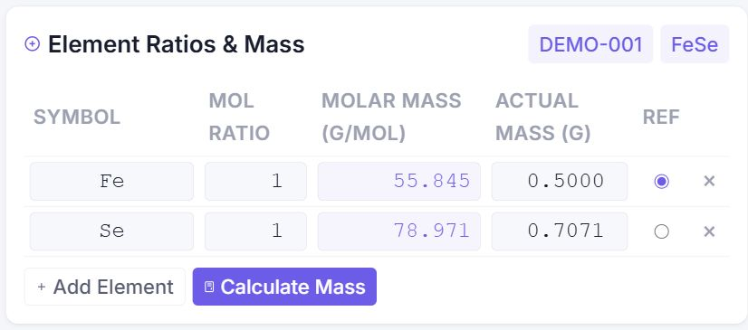
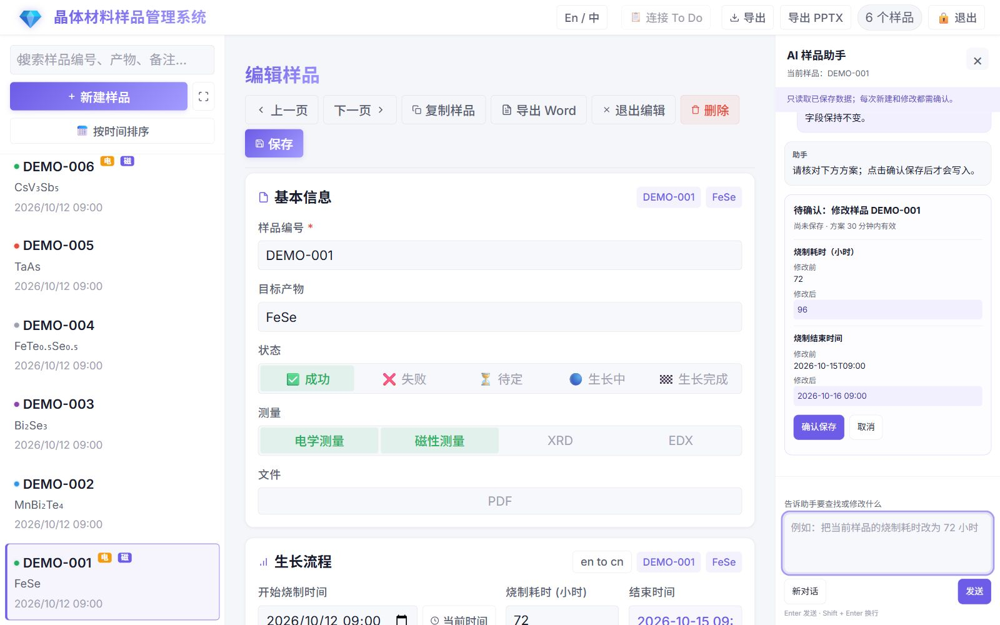

# 💎 Crystal Material Sample Management System & 晶体材料样品管理系统

[简体中文](README_zh.md)

A local web application designed to manage all information regarding samples obtained from crystal growth experiments.

## Screenshots

Screenshots from a local instance using illustrative demo data.

### Sample Overview

Full-screen sample list with search, status indicators, and measurement badges (Chinese UI).



### Element Ratios & Mass Calculation

Enter molar ratios and a reference element's mass to calculate the required masses of the other elements.



### AI Assistant with Confirmation

The assistant searches saved text and reads multiple exact sample IDs for comparison. It can prepare up to 20 creates or updates together, showing a separate confirmation and undo card for each sample. On phones and tablets it opens from the bottom of the screen.



[View the phone layout](docs/screenshots/ai-assistant-mobile.jpg).

## Features

- **AI Sample Assistant** — A right-hand desktop panel and a floating bottom drawer on phones/tablets. Server-stored conversations support new chats, history switching, refresh recovery and continuation across signed-in devices with shared history. Search saved samples, prepare new records, or propose changes to growth procedures, sintering schedules, element ratios and masses. Every create/update shows a before/after confirmation card and requires an explicit click before saving. Each save can be undone within 30 minutes after another confirmation; later edits or attachments protect new records from removal. Uses separate `AI_CHAT_*` configuration and a [sample-operation skill](ai_skills/sample-management.md); the model must support tool calling. See the [assistant guide](docs/ai-assistant.md) for data scope and confirmation behavior.
- **Sample Management** — Create, view, edit, delete, search, and manually sort samples via drag-and-drop.
- **Basic Info** — Sample ID, Target Product, Status (Success/Fail/Pending/Growing/Completed), Unique Measurements (Electric/Magnetic), Growth Process & Sintering Time Tracking, Results, Notes.
- **Enhanced Navigation & UX** — One-click fast previous/next navigation, auto-resizing textareas, intelligent anti-scroll during saves, and smart duplication that preserves custom reference elements.
- **Mass Calculation** — Intuitive display of current context (ID/Product); input element molar ratios + mass of one reference element to automatically calculate the required mass for other elements.
- **Export** — Export all samples as CSV or PPTX, or export individual sample reports (bilingual) directly to Microsoft Word (`.docx`). The PPTX export starts with an overview table containing Sample ID, Target Sample, and Status, followed by one slide per sample with a color-coded title and separate result/growth-method areas. Intelligent filename generation based on ID, target product, and status.
- **Photos & XRD** — Multiple photo/XRD image uploads (supports camera capture), automatic lazy-loaded thumbnails, zoom preview, and perfectly restored original filenames upon download. XRD/EDX statuses are automatically adjusted based on uploads. Non-image data files in XRD and other sections support direct inline opening (PDF) or downloading. Word export perfectly formats image spacing and omits filenames for physical photos to maintain report cleanliness.
- **EDX Analysis** — Upload EDX spectrum images (auto-generates thumbnails) → uses GPT Vision API to automatically recognize INCA-style elemental composition, with manual reordering support for EDX data cards.
- **Data & Other Files** — Upload/download `.dat/.csv/.txt/.pdf` and any other ad-hoc attachment files with reliable strict original filename retention.
- **Microsoft To Do Integration** — Bind your Microsoft account to automatically sync sintering end times directly to To Do for robust cross-device reminders.
- **Global Timezone Configuration** — Independent timezone setting decoupled from server location to ensure consistent time synchronization between frontend and database.
- **Bilingual & Responsive UI** — Seamless dynamic i18n switching (EN/ZH); deep layout and touch optimizations for mobile and tablet, plus a widescreen fullscreen mode.
- **Bilingual Results & Growth Process with Manual Translation** — Chinese and English results are stored separately (`results` / `results_en`), and growth processes are stored separately (`growth_process` / `growth_process_en`). Legacy Chinese growth text is preserved during migration; the new English field starts empty and is not batch-translated. The Chinese UI shows the `en to cn` button and the English UI shows `cn to en` for both sections. Translation uses `POST /api/results/translate`, directly reusing the same OpenAI-compatible API, client, and configuration as EDX image recognition. It updates only the current form draft; use manual save by clicking Save/保存, with no auto-save to the database. Copying a sample preserves both growth-process fields while results remain cleared.
- **Language-Specific Word/CSV/PPTX Export** — Word exports use the `lang` value to select corresponding saved fields (`zh` → `growth_process` / `results`, `en` → `growth_process_en` / `results_en`) and never fall back across languages. Total CSV/PPTX exports first open a sample-selection dialog, default to all samples, and export only the checked samples. The selection dialog keeps the current sample-list order, while the actual CSV/PPTX output uses the exact reverse of that current order, so no independent time-field sorting is applied. CSV has five columns: Sample ID, Target Sample, Status, Result Text, and Growth Method; element ratios are placed on the first line of the Growth Method cell and the language-specific growth process follows on a new line. PPTX creates one overview table plus one slide per selected sample. The CSV/PPTX GET routes continue to export all samples for backward compatibility; selected exports use POST with a JSON `sample_ids` list. Unsaved drafts are not included in exported files.
- **Auto Backup** — Complete database snapshots include chat and action records. Daily incrementals track attachment additions, changes, and deletions; restoration applies a full baseline and its subsequent incremental chain with a CLI preview and confirmation.

## Tech Stack

| Component | Technology |
|-----------|------------|
| Backend | Python / Flask / Pillow / python-pptx (PPTX export) |
| Database | SQLite |
| Frontend | HTML / CSS / Vanilla JavaScript |
| AI Vision | OpenAI-compatible APIs (GPT-4o / Gemini) |

## Quick Start

### 1. Install Dependencies

```bash
pip install -r requirements.txt
```

### 2. Create Configuration

Copy `config.py.example` to `config.py` and enter your own password and API Key:

```bash
cp config.py.example config.py
```

Then edit `config.py`:

```python
LOGIN_PASSWORD = "your-password"                # Login password
APP_PORT = 5000                                 # Server port
TIMEZONE_OFFSET_HOURS = 8                       # Timezone offset (e.g. 8 for CST)
OPENAI_API_KEY = "sk-your-api-key"              # API Key for EDX recognition and manual translation
OPENAI_BASE_URL = "https://api.openai.com/v1/"  # Reverse proxy / base URL
OPENAI_MODEL = "gpt-4o"                         # Model name

AI_CHAT_API_KEY = "sk-your-chat-api-key"         # Separate API Key for the chat assistant
AI_CHAT_BASE_URL = "https://api.openai.com/v1/" # Chat base URL
AI_CHAT_MODEL = "gpt-4o"                        # Chat model with tool calling support
```

Existing deployments: add all three `AI_CHAT_*` settings to `config.py` and restart the Python process to use the assistant.

### 3. Run the App

```bash
python app.py
```

Visit http://127.0.0.1:5000 and log in with your password. Debug mode and automatic reloading are disabled by default.

## Project Structure

```
crystal_manager/
├── app.py              # Flask app & API routes
├── config.py.example   # Config template (copy to config.py)
├── models.py           # SQLite database operations
├── backup.py           # Incremental & full backup & scheduler
├── restore_backup.py   # CLI tool for backup restoration
├── migrate_storage.py  # File storage migration tool
├── molmass_data.py     # Element molar masses data
├── requirements.txt    # Python deps
├── templates/
│   ├── index.html      # Main UI
│   └── login.html      # Login page
├── static/
│   ├── css/style.css   # Light theme stylesheet
│   └── js/app.js       # Frontend logic
├── uploads/            # Uploaded files (organized by sample ID)
│   └── <Sample_ID>/
│       ├── photos/
│       ├── edx/
│       ├── data/
│       └── others/
├── backups/            # Incremental backup directory (auto-created)
│   ├── manifest.json   # Incremental backup manifest
│   └── <timestamp>/
│       ├── db.sqlite       # Database snapshot
│       ├── files/          # Incremental new/modified files
│       └── backup_info.json
└── full_backups/       # Full backup directory (auto-created)
    └── full_<timestamp>.zip  # Complete zip archive (DB + all uploads)
```

## Calculation Formula

Given reference element A's mass `m_A`, molar ratio `r_A`, and molar mass `M_A`, the mass of element B is calculated as:

```
m_B = m_A × (r_B / r_A) × (M_B / M_A)
```

## APIs

| Method | Path | Description |
|--------|------|-------------|
| GET | `/api/samples?q=xxx` | List & Search samples |
| POST | `/api/samples` | Create new sample |
| GET | `/api/samples/<id>` | Sample details |
| PUT | `/api/samples/<id>` | Update sample |
| DELETE | `/api/samples/<id>` | Delete sample |
| POST | `/api/samples/reorder` | Update sample sorting order |
| GET, POST | `/api/samples/export?lang=zh` | Export all samples (GET) or selected samples (POST `sample_ids`) to language-specific CSV (`lang=zh` or `lang=en`) |
| GET, POST | `/api/samples/export_pptx?lang=zh` | Export all samples (GET) or selected samples (POST `sample_ids`) to a language-specific PPTX (`lang=zh` or `lang=en`) |
| GET | `/api/samples/<id>/export_word?lang=zh`| Export sample to language-specific Word (`lang=zh` or `lang=en`) |
| POST | `/api/samples/<id>/photos` | Upload photos |
| POST | `/api/samples/<id>/xrd` | Upload XRD images |
| POST | `/api/samples/<id>/edx` | Upload EDX images |
| POST | `/api/edx/<id>/recognize` | AI EDX Recognition |
| POST | `/api/results/translate` | Translate the current result or growth-process draft between Chinese and English (does not save it) |
| POST | `/api/edx/reorder` | Update EDX images order |
| POST | `/api/samples/<id>/datafiles` | Upload data files |
| POST | `/api/samples/<id>/otherfiles`| Upload other files |
| POST | `/api/calculate_mass` | Calculate element masses |

## Backup and Restore

Backups include the entire SQLite database: samples, chat conversations, messages, and confirmation / cancellation / save / undo states. Uploaded files are also backed up. Microsoft To Do cloud tasks are outside the local backup scope.

Startup runs a full backup followed by an incremental backup. The default intervals are 24 hours for incrementals and 7 days for full backups. A full archive contains the database and every upload. Each incremental contains a complete database snapshot, added / modified attachments, deletion records, and links to its full baseline and previous incremental. The first incremental, including after an upgrade from the old format, creates a full baseline if needed.

### Restore Rules

A restore selects the latest full backup at or before the requested backup timestamp, then applies every subsequent incremental in order. You can also select a full archive and restore through the last incremental in its chain, stopping before the next full backup, or choose a target within that chain.

The CLI previews the full baseline, ordered incrementals, and destination paths before requiring `y`. Files are rebuilt in a temporary directory and the chain, files, and database are checked before replacing the destination data. Attachments left over from a later state are removed. Missing incrementals or damaged backups cause an error.

**Stop the application before restoring and restart it afterward.** Restoring chat actions preserves their original confirmation / undo expiration times.

### Configuration

`config.py.example` includes these settings; check your existing `config.py` when upgrading:

```python
BACKUP_FOLDER = os.path.join(BASE_DIR, "backups")
FULL_BACKUP_FOLDER = os.path.join(BASE_DIR, "full_backups")
BACKUP_INTERVAL_HOURS = 24
BACKUP_KEEP_COUNT = 100000
FULL_BACKUP_INTERVAL_HOURS = 168
FULL_BACKUP_KEEP_COUNT = 10
```

Keep at least one full backup. The incremental count is a cleanup target: increments required by retained baselines are protected, so the count can temporarily exceed `BACKUP_KEEP_COUNT`. When transferring backups, retain the required full zip and its entire subsequent incremental chain.

### CLI Utilities

```bash
# List backups; copy actual timestamps / filenames from this output
python restore_backup.py list

# Create a backup immediately
python restore_backup.py backup
python restore_backup.py full-backup

# Restore the latest available point: full baseline + subsequent incrementals
python restore_backup.py restore

# Restore a specific backup point
python restore_backup.py restore 2026-10-18_22-00-00_123456

# Choose a full baseline and apply subsequent incrementals in its chain
python restore_backup.py full-restore full_2026-10-12_22-00-00_123456.zip

# Choose a full baseline and a target within its chain
python restore_backup.py full-restore full_2026-10-12_22-00-00_123456.zip 2026-10-18_22-00-00_123456

# Interactive menu
python restore_backup.py
```

New timestamps include microseconds; use the exact values from `list`. The original `python restore_backup.py <timestamp>` form and older second-resolution timestamps remain supported.

Legacy backups remain readable when a full baseline is available. Old incrementals lack predecessor links and deletion records, so missing steps cannot be verified and historic attachment deletions cannot be reconstructed. The CLI warns before restoring those increments. New backup chains include these records.
