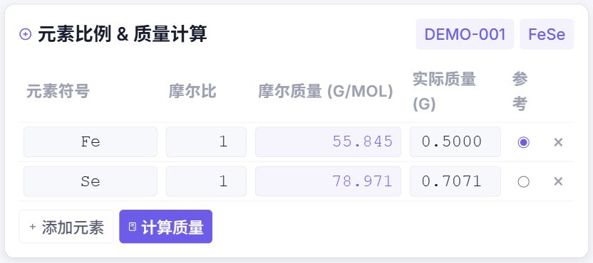

# 💎 晶体材料样品管理系统 (Crystal Material Sample Management System)

[English](README.md)

本地 Web 应用，用于管理晶体生长实验所得样品的全部信息。

## 界面展示

以下截图来自本地运行的应用，使用的均为演示数据。

### 样品总览

全屏样品列表，集中展示样品编号、目标产物、状态标记和测量标签，并支持搜索。


### 元素比例与质量计算

输入元素摩尔比和参考元素质量，自动计算其余元素的称量质量。



### AI 助手与操作确认

支持检索已保存文字、多编号精确读取与比较，一次为最多 10 个编号生成新建或修改方案，每个样品独立确认、取消和撤销。手机和平板通过底部浮动入口展开抽屉。


[查看手机布局](docs/screenshots/ai-assistant-mobile.jpg)。

## 功能特性

- **AI 样品助手** — 桌面最右侧独立面板，手机和平板底部浮动抽屉。服务端保存会话，支持新建、历史切换、刷新恢复和已登录设备间续聊（共享历史）。支持查询样品、新建记录及修改生长制度、烧制时间、元素比例和称量质量。每次新建或修改都展示前后对比，必须点击“确认保存”才写入；保存后 30 分钟内可点击撤销并再次确认，恢复修改前内容或撤回新建。后续修改及附件会保护新建记录免被撤回。使用独立的 `AI_CHAT_*` 接口配置，模型需支持工具调用，并加载[样品操作技能](ai_skills/sample-management.md)。数据范围和确认规则见[使用说明](docs/ai-assistant.md)。
- **样品管理** — 新建、查看、编辑、删除、按状态及参数搜索样品，并支持全屏模式下的拖拽手动排序
- **基本信息** — 样品编号、目标产物、状态（成功/失败/待定/生长中/已出炉）、专属测量标记（电学/磁性）、生长流程与烧制时间记录、结果、备注
- **快捷导航与体验** — 极速的前后样品切换、文本框高度自适应、智能避免自动滚动，及支持保留参考元素的快速复制功能
- **元素质量计算** — 直观展示当前计算环境（样品ID/产物）；输入元素摩尔比和某参考元素质量，自动计算其余元素称量质量
- **数据导出** — 支持一键导出所有样品数据至 CSV 或 PPTX 文件，也支持将单一样品报告（双语）导出为 Word (`.docx`)。总 CSV/PPTX 导出会先打开样品选择窗口，默认全选，也可只导出勾选样品。PPTX 首页为编号、目标样品、是否成功三列表格，后续每个样品一页，标题根据状态着色，并分别显示结果和生长方法区域。文件名根据样品编号、目标产物和状态智能生成。
- **实物照片与XRD** — 照片与XRD图片上传（支持拍照）、自动生成缩略图（按需加载）、点击放大预览原图、原生文件名还原下载，并根据上传自动调整测量状态。非图片的 XRD 和附件数据可以直接在网页端打开预览 (如 PDF)。导出 Word 时，图片排版精确居中、留空隔开，并在 XRD 图片上方展示文件名，实物照片则自动隐藏文件名以保持报告整洁。
- **EDX 能谱分析** — 上传 EDX 谱图生成缩略图 → 调用 GPT Vision API 自动识别 INCA 表格成分，并支持 EDX 卡片的上下排序调整
- **数据与附件区** — 支持上传/下载 `.dat/.csv/.txt/.pdf` 等实验数据文件以及不限格式的其他附件，完美还原原始文件名
- **Microsoft To Do 深度集成** — 绑定微软账户，自动同步样品的烧制结束时间，实现高效的多端到期提醒
- **系统级时区配置** — 独立于部署服务器所在地的时区设置，确保前端展示与后端数据库时间无缝一致
- **双语与响应式设计** — 支持中英文 (i18n) 动态无缝切换；为手机、平板深度优化的独立排版结构和交互体验；提供全屏的宽屏浏览模式
- **双语结果、生长流程与手动翻译** — 中文和英文结果分别保存到 `results` / `results_en`，中文和英文生长流程分别保存到 `growth_process` / `growth_process_en`。迁移时保留旧中文生长流程，新英文字段初始为空，不会批量翻译。中文界面两个区均显示 `en to cn` 按钮，英文界面均显示 `cn to en`。翻译通过 `POST /api/results/translate` 完成，直接复用 EDX 图片识别使用的同一个 OpenAI-compatible API、client 和配置。翻译只更新当前表单草稿，必须手动点击 Save/保存（manual save）才会写入数据库，不会自动保存（no auto-save）。复制样品时保留中英文两个生长流程字段，但结果字段仍按现有逻辑清空。
- **按语言导出 Word/CSV/PPTX** — Word 导出根据 `lang` 选择对应的已保存字段（`zh` → `growth_process` / `results`，`en` → `growth_process_en` / `results_en`），不会跨语言 fallback。总 CSV/PPTX 导出默认包含全部样品，也可通过选择窗口导出勾选的样品。选择窗口保持当前样品列表顺序，但实际 CSV/PPTX 导出时严格使用当前顺序的倒序，不根据时间字段另行排序，使当前列表最后的样品最先导出。GET 接口继续导出全部，POST + `sample_ids` 导出指定样品。CSV 固定为五列：编号、目标样品、是否成功、结果中的文字、生长方法。元素比例放在“生长方法”单元格第一行，下面换行显示对应语言的生长流程。PPTX 首页为样品总览表格，后续每个选中样品一页。未保存的草稿不会出现在导出文件中（language-specific Word/CSV/PPTX exports）。
- **自动备份** — 含聊天及操作记录的整库备份；每日增量记录附件新增、修改和删除，恢复使用完整基线及后续增量链。配套命令行预览与确认。

## 技术栈

| 组件 | 技术 |
|------|------|
| 后端 | Python / Flask / Pillow / python-pptx (PPTX 导出) |
| 数据库 | SQLite |
| 前端 | HTML / CSS / JavaScript |
| AI 识别 | OpenAI 兼容 API (GPT-4o / Gemini-3.1pro) |

## 快速开始

### 1. 安装依赖

```bash
pip install -r requirements.txt
```

### 2. 创建配置文件

复制 `config.py.example` 为 `config.py`，并填入你自己的密码和 API Key：

```bash
cp config.py.example config.py
```

然后编辑 `config.py`，修改以下内容：

```python
LOGIN_PASSWORD = "your-password"                # 登录密码
APP_PORT = 5000                                 # 服务端口
TIMEZONE_OFFSET_HOURS = 8                       # 系统时区偏移量 (如北京时间为 8)
OPENAI_API_KEY = "sk-your-api-key"              # EDX 识别与手动翻译用 API Key
OPENAI_BASE_URL = "https://api.openai.com/v1/"  # 代理地址
OPENAI_MODEL = "gpt-4o"                         # 模型名称

AI_CHAT_API_KEY = "sk-your-chat-api-key"         # 聊天助手独立的 API Key
AI_CHAT_BASE_URL = "https://api.openai.com/v1/" # 聊天接口地址
AI_CHAT_MODEL = "gpt-4o"                        # 支持工具调用的聊天模型
```

已有部署：在 `config.py` 中补充上述三项 `AI_CHAT_*` 配置，填写后重启 Python 进程即可使用聊天助手。

### 3. 启动

```bash
python app.py
```

访问 http://127.0.0.1:5000 ，输入密码登录。debug 模式和自动重载默认关闭。

## 项目结构

```
crystal_manager/
├── app.py              # Flask 主应用 & API 路由
├── config.py.example   # 配置文件模板 (复制为 config.py 使用)
├── models.py           # SQLite 数据库操作
├── backup.py           # 增量 & 完整备份 & 定时调度器
├── restore_backup.py   # 命令行备份恢复工具
├── migrate_storage.py  # 文件存储结构迁移工具
├── molmass_data.py     # 元素摩尔质量数据
├── requirements.txt    # Python 依赖
├── templates/
│   ├── index.html      # 主页面
│   └── login.html      # 登录页面
├── static/
│   ├── css/style.css   # 亮色主题样式
│   └── js/app.js       # 前端逻辑
├── uploads/            # 上传文件目录 (按样品编号组织)
│   └── <样品编号>/
│       ├── photos/
│       ├── edx/
│       ├── data/
│       └── others/
├── backups/            # 增量备份目录 (自动创建)
│   ├── manifest.json   # 增量备份清单
│   └── <时间戳>/
│       ├── db.sqlite       # 数据库快照
│       ├── files/          # 增量文件
│       └── backup_info.json
└── full_backups/       # 完整备份目录 (自动创建)
    └── full_<时间戳>.zip   # 完整压缩包 (数据库 + 全部上传文件)
```

## 元素质量计算公式

给定参考元素 A 的质量 `m_A`、摩尔比 `r_A`、摩尔质量 `M_A`，
计算元素 B 的质量：

```
m_B = m_A × (r_B / r_A) × (M_B / M_A)
```

## API 接口

| 方法 | 路径 | 说明 |
|------|------|------|
| GET | `/api/samples?q=xxx` | 样品列表 & 搜索 |
| POST | `/api/samples` | 新建样品 |
| GET | `/api/samples/<id>` | 样品详情 |
| PUT | `/api/samples/<id>` | 更新样品 |
| DELETE | `/api/samples/<id>` | 删除样品 |
| POST | `/api/samples/reorder` | 更新样品排序 |
| GET, POST | `/api/samples/export?lang=zh` | 按语言导出全部样品（GET）或勾选样品（POST `sample_ids`）为 CSV（`lang=zh` 或 `lang=en`） |
| GET, POST | `/api/samples/export_pptx?lang=zh` | 按语言导出全部样品（GET）或勾选样品（POST `sample_ids`）为 PPTX（`lang=zh` 或 `lang=en`） |
| GET | `/api/samples/<id>/export_word?lang=zh`| 按语言导出样品为 Word（`lang=zh` 或 `lang=en`） |
| POST | `/api/samples/<id>/photos` | 上传照片 |
| POST | `/api/samples/<id>/xrd` | 上传 XRD 图片 |
| POST | `/api/samples/<id>/edx` | 上传 EDX 图片 |
| POST | `/api/edx/<id>/recognize` | AI 识别 EDX |
| POST | `/api/results/translate` | 在中英文之间翻译当前结果或生长流程草稿（不会保存） |
| POST | `/api/edx/reorder` | EDX 图片排序 |
| POST | `/api/samples/<id>/datafiles` | 上传数据文件 |
| POST | `/api/samples/<id>/otherfiles`| 上传其他文件 |
| POST | `/api/calculate_mass` | 元素质量计算 |

## 备份与恢复

备份覆盖整个 SQLite 数据库：样品、聊天会话、消息及确认 / 取消 / 保存 / 撤销状态均包含在内。上传文件也会备份；Microsoft To Do 云端任务不属于本地备份范围。

启动时先执行完整备份，再执行增量备份；之后默认每 24 小时增量、每 7 天完整备份。完整备份打包数据库及全部上传文件。每次增量保存完整数据库快照、附件新增 / 修改内容及删除记录，并记录所属完整基线和前序增量。首次使用或升级旧格式时，会先建立新的完整基线。

### 恢复规则

恢复到某个备份时间点时，自动选择该时间点之前最近的完整备份，再按顺序应用之后的所有增量。也可指定完整备份，恢复到该基线所属恢复链的最后一个时间点（下一份完整备份之前），或明确指定链内目标。

工具先展示完整基线、增量顺序和覆盖目标，输入 `y` 后才执行。在临时目录重建文件并检查恢复链、文件及数据库，通过后替换目标数据，清除目标时间点之后残留的附件。缺失增量或备份损坏时会报错。

**恢复前必须停止应用，恢复完成后重新启动。** 聊天操作的确认 / 撤销期限仍按原生成时间计算，恢复不会续期。

### 配置

`config.py.example` 已包含以下设置；已有部署请检查自己的 `config.py`：

```python
BACKUP_FOLDER = os.path.join(BASE_DIR, "backups")
FULL_BACKUP_FOLDER = os.path.join(BASE_DIR, "full_backups")
BACKUP_INTERVAL_HOURS = 24
BACKUP_KEEP_COUNT = 100000
FULL_BACKUP_INTERVAL_HOURS = 168
FULL_BACKUP_KEEP_COUNT = 10
```

完整备份至少保留 1 份。增量数量是清理目标；仍被保留基线依赖的增量不会删除，因此可能暂时超过 `BACKUP_KEEP_COUNT`。转移备份时，应同时保留所需完整 zip 和之后的整段增量目录。

### 命令行工具

```bash
# 查看备份，复制实际时间戳 / 文件名
python restore_backup.py list

# 立即备份
python restore_backup.py backup
python restore_backup.py full-backup

# 恢复到最新可用时间点：自动完整基线 + 后续增量
python restore_backup.py restore

# 恢复到指定时间点
python restore_backup.py restore 2026-10-18_22-00-00_123456

# 指定完整基线，叠加其恢复链内的后续增量
python restore_backup.py full-restore full_2026-10-12_22-00-00_123456.zip

# 指定完整基线和链内目标
python restore_backup.py full-restore full_2026-10-12_22-00-00_123456.zip 2026-10-18_22-00-00_123456

# 交互式菜单
python restore_backup.py
```

新备份时间戳包含微秒，以 `list` 输出为准。原来的 `python restore_backup.py <时间戳>` 命令和秒级旧时间戳仍可使用。

旧格式备份在有完整基线时仍可读取；旧增量没有前序及删除记录，无法验证中间是否缺失，也无法还原当时未记录的附件删除，恢复前会提示该限制。新生成的恢复链包含这些记录。
